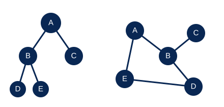
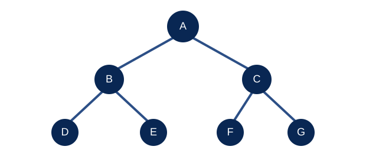
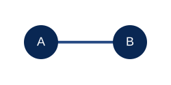
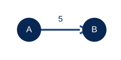

<!-- _class: lead -->
<!-- _paginate: false -->
<!-- _footer: '' -->

<span class="tag">Engenharia de Software</span>

# Estruturas Não Lineares

<div class="line"></div>

## Organização e Manipulação de Estruturas de Dados

Árvores · Grafos · Relações · Percursos

---

# 🎯 Objetivos de aprendizagem

<div class="cards">
  <div class="card"><span class="ico">🌳</span><b>Compreender</b>como árvores organizam dados em hierarquias</div>
  <div class="card"><span class="ico">🔗</span><b>Representar</b>relações entre elementos por meio de grafos</div>
  <div class="card"><span class="ico">🧭</span><b>Percorrer</b>árvores e grafos com algoritmos conhecidos</div>
  <div class="card"><span class="ico">💻</span><b>Implementar</b>exemplos introdutórios em JavaScript</div>
  <div class="card"><span class="ico">⚖️</span><b>Escolher</b>uma estrutura adequada ao tipo de relação</div>
  <div class="card"><span class="ico">🛠️</span><b>Relacionar</b>as estruturas a aplicações de software</div>
</div>

---

# 🔄 Da sequência às relações

<div class="cols">
<div>

### Revisão: estruturas lineares

- Arrays e listas encadeadas
- Pilhas (LIFO) e filas (FIFO)
- Os elementos formam uma sequência

</div>
<div>

### Estruturas não lineares

Um elemento pode se relacionar com vários outros, sem que todos formem uma única sequência.

- **Árvores** representam hierarquias, como pastas e categorias
- **Grafos** representam conexões, como rotas e redes sociais

</div>
</div>

<div class="callout">A estrutura escolhida acompanha o problema: <strong>hierarquias</strong> ou <strong>conexões</strong>.</div>

---

# 📊 Sequência, hierarquia e conexões

<div class="cols">
<div>

### Sequência linear

```text
A → B → C → D
```

Cada elemento tem um caminho principal ao próximo.

</div>
<div>

### Hierarquia e conexões



**Árvore:** ramificações por níveis. **Grafo:** conexões podem formar caminhos alternativos e ciclos.

</div>
</div>

---

# 🌳 Introdução às árvores

Uma **árvore** é uma coleção de nós conectados por arestas, organizada a partir de uma **raiz**.



**A** é a raiz; **B** e **C** são nós internos; **D**, **E**, **F** e **G** são folhas.

---

# 🧩 Vocabulário das árvores

<div class="cols">
<div>

Na árvore do slide anterior:

- **Aresta:** conexão entre dois nós
- **Pai e filho:** relação direta, como A e B
- **Ancestral e descendente:** relação ao longo de um caminho
- **Folha:** nó sem filhos

</div>
<div>

- **Nível:** posição em camadas a partir da raiz
- **Profundidade:** número de arestas da raiz até o nó
- **Altura da árvore:** maior caminho da raiz até uma folha

Adotamos **profundidade 0 para a raiz** e medimos altura em arestas: nesta árvore, a altura é 2.

</div>
</div>

<div class="note"><strong>Importante:</strong> alguns materiais contam níveis a partir de 1 ou medem altura em nós. Sempre declare a convenção usada.</div>

---

# 🗂️ Analogia cotidiana: árvore de pastas

Imagine organizar documentos em gavetas e pastas. Cada pasta pode conter subpastas; cada arquivo fica em um nível da hierarquia.

```text
Documentos
├── Faculdade
│   ├── Estruturas de Dados
│   └── Projeto
└── Pessoal
    └── Currículo.pdf
```

`Documentos` é a raiz; `Faculdade` e `Pessoal` são ramificações; arquivos sem subpastas funcionam como folhas. Para chegar a um arquivo, seguimos um caminho pela hierarquia.

---

# 🖥️ Árvores em softwares reais

<div class="cards c2">
  <div class="card"><b>Gerenciadores de arquivos</b>No Windows, macOS e Linux, pastas contêm subpastas e arquivos. O caminho indica os níveis até o item.</div>
  <div class="card"><b>Navegadores web</b>O DOM representa elementos HTML como nós com relações pai-filho. O navegador percorre essa árvore para exibir e atualizar a página.</div>
</div>

<div class="note"><strong>Outro exemplo:</strong> menus e categorias de lojas virtuais agrupam opções e produtos em níveis. A interface apresenta a hierarquia; a implementação pode variar.</div>

---

# 🌿 O que torna uma árvore binária?

Em uma **árvore binária**, cada nó pode ter **no máximo dois filhos**: um à esquerda e outro à direita.

<div class="cols">
<div>

```text
       A
      / \
     B   C
    /
   D
```

Os filhos podem estar ausentes; um nó não precisa ter exatamente dois.

</div>
<div>

```text
       A
      /|\
     B C D
```

Esta configuração **não é binária**: A tem três filhos.

</div>
</div>

<div class="callout">Árvore binária define a quantidade de filhos. Ela <strong>não exige ordenação</strong> dos valores.</div>

---

# 🔎 Árvore binária de busca (BST)

Uma **BST** é uma árvore binária com uma regra de ordenação:

<div class="cols">
<div>

Para cada nó:

- Valores menores ficam à esquerda
- Valores maiores ficam à direita
- A regra vale para cada subárvore

Inserindo `8, 3, 10, 1, 6, 14, 4, 7`:

</div>
<div>

```text
        8
       / \
      3   10
     / \    \
    1   6    14
       / \
      4   7
```

Buscar `6`: compare com 8 → esquerda; compare com 3 → direita; encontrou.

</div>
</div>

---

# 🎲 Analogia: jogo de adivinhar o número

Pense em um jogo no qual alguém escolhe um número e responde “maior” ou “menor”.

Para encontrar `6` na árvore do exemplo:

1. Compare com `8`: 6 é menor; siga à esquerda.
2. Compare com `3`: 6 é maior; siga à direita.
3. Chegue a `6`: valor encontrado.

Como no jogo, cada comparação elimina um ramo impossível. Uma árvore desequilibrada, porém, pode exigir muitas tentativas.

---

<!-- _class: dense -->
# 🧩 Representando um nó

Cada nó guarda um valor e referências para os filhos. Se não houver filho, usamos `null`.

```js
class No { // Modelo de cada elemento da árvore
  constructor(valor) { // Recebe o dado que ficará neste nó
    this.valor = valor; // Guarda o dado
    this.esquerda = null; // Ainda não há filho à esquerda
    this.direita = null; // Ainda não há filho à direita
  }
}

const raiz = new No(8); // Cria a raiz com valor 8
raiz.esquerda = new No(3); // Liga o nó 3 à esquerda
raiz.direita = new No(10); // Liga o nó 10 à direita
```

A raiz `8` referencia os filhos `3` e `10`. A classe `No` será usada nos próximos exemplos.

---

<!-- _class: dense -->
# 💻 Inserindo valores em uma BST

Compare o valor com a raiz; siga à esquerda se for menor e à direita se for maior. Insira quando encontrar espaço.

```js
class ArvoreBusca { // Define uma árvore binária de busca
  constructor() { this.raiz = null; } // Começa sem nós
  inserir(valor) {
    const novo = new No(valor); // Prepara o nó que será inserido
    if (!this.raiz) { this.raiz = novo; return; } // Primeiro valor vira raiz
    let atual = this.raiz; // Começa a busca de posição pela raiz
    while (true) {
      if (valor === atual.valor) return; // Evita inserir valores repetidos
      const lado = valor < atual.valor ? "esquerda" : "direita"; // Escolhe o ramo
      if (!atual[lado]) { atual[lado] = novo; return; } // Liga no primeiro espaço livre
      atual = atual[lado]; // Continua comparando no próximo nó
    }
  }
}

const arvore = new ArvoreBusca(); // Cria a árvore vazia
[8, 3, 10, 1, 6, 14, 4, 7].forEach(v => arvore.inserir(v)); // Insere os valores em sequência
```

Cada comparação escolhe o ramo. Os valores duplicados são ignorados nesta implementação.

---

# 🔍 Busca em uma árvore de busca

A propriedade da BST permite descartar metade dos caminhos possíveis a cada comparação — quando a árvore está equilibrada.

```js
function buscar(raiz, valor) {
  let atual = raiz; // Começa a busca pela raiz
  while (atual !== null) { // Continua enquanto houver nó para verificar
    if (valor === atual.valor) return atual; // Retorna ao encontrar o valor
    atual = valor < atual.valor ? atual.esquerda : atual.direita; // Escolhe um ramo
  }
  return null; // Chegou ao fim sem encontrar o valor
}

const encontrado = buscar(arvore.raiz, 6); // Procura o valor 6
console.log(encontrado?.valor ?? "não encontrado"); // Exibe 6 ou uma mensagem
```

Na árvore equilibrada, busca e inserção podem levar `O(log n)`; no pior caso, uma árvore degenerada exige `O(n)`.

---

# ⬇️ Pré-ordem: raiz, esquerda, direita

**Regra:** visite o nó atual, depois a subárvore esquerda e, por fim, a direita (**raiz → esquerda → direita**).

```text
        8①
       /  \
     3②   10⑦
     / \      \
   1③  6④     14⑧
       / \
     4⑤  7⑥
```

Sequência de visita: **8, 3, 1, 6, 4, 7, 10, 14**.

---

<!-- _class: dense -->
# 💻 Código: pré-ordem

O nó atual é registrado antes de visitar os filhos.

```js
function preOrdem(no, resultado = []) {
  if (no === null) return resultado; // Para ao alcançar um ramo vazio
  resultado.push(no.valor); // Visita primeiro a raiz deste ramo
  preOrdem(no.esquerda, resultado); // Percorre depois o ramo esquerdo
  preOrdem(no.direita, resultado); // Percorre por último o ramo direito
  return resultado; // Devolve a sequência acumulada
}

console.log(preOrdem(arvore.raiz)); // Executa o percurso a partir da raiz
// Resultado: [8, 3, 1, 6, 4, 7, 10, 14]
```

Pré-ordem pode ser útil para serializar uma árvore começando pela raiz de cada subárvore.

---

# ↔️ Em ordem: esquerda, raiz, direita

**Regra:** visite a subárvore esquerda, o nó atual e a subárvore direita (**esquerda → raiz → direita**).

```text
        8⑥
       /  \
     3②   10⑦
     / \      \
   1①  6④     14⑧
       / \
     4③  7⑤
```

Sequência de visita: **1, 3, 4, 6, 7, 8, 10, 14**.

---

<!-- _class: dense -->
# 💻 Código: em ordem

O nó atual é registrado entre as visitas dos dois ramos.

```js
function emOrdem(no, resultado = []) {
  if (no === null) return resultado; // Para ao alcançar um ramo vazio
  emOrdem(no.esquerda, resultado); // Visita primeiro o ramo esquerdo
  resultado.push(no.valor); // Visita a raiz deste ramo
  emOrdem(no.direita, resultado); // Visita por último o ramo direito
  return resultado; // Devolve a sequência acumulada
}

console.log(emOrdem(arvore.raiz)); // Executa o percurso a partir da raiz
// Resultado: [1, 3, 4, 6, 7, 8, 10, 14]
```

Em uma BST, o percurso em ordem visita os valores em ordem crescente.

---

# ⬆️ Pós-ordem: esquerda, direita, raiz

**Regra:** visite as subárvores esquerda e direita antes do nó atual (**esquerda → direita → raiz**).

```text
        8⑧
       /  \
     3⑤   10⑦
     / \      \
   1①  6④     14⑥
       / \
     4②  7③
```

Sequência de visita: **1, 4, 7, 6, 3, 14, 10, 8**.

---

<!-- _class: dense -->
# 💻 Código: pós-ordem

O nó atual só é registrado depois de percorrer os dois ramos.

```js
function posOrdem(no, resultado = []) {
  if (no === null) return resultado; // Para ao alcançar um ramo vazio
  posOrdem(no.esquerda, resultado); // Percorre primeiro o ramo esquerdo
  posOrdem(no.direita, resultado); // Percorre depois o ramo direito
  resultado.push(no.valor); // Visita a raiz somente após os filhos
  return resultado; // Devolve a sequência acumulada
}

console.log(posOrdem(arvore.raiz)); // Executa o percurso a partir da raiz
// Resultado: [1, 4, 7, 6, 3, 14, 10, 8]
```

Útil quando os filhos precisam ser processados antes do nó, como ao liberar uma árvore.

---

# 🧭 Os três percursos lado a lado

Usando sempre a mesma árvore, muda apenas o momento em que o nó atual é visitado.

| Percurso | Regra | Sequência |
|---|---|---|
| Pré-ordem | Raiz → esquerda → direita | 8, 3, 1, 6, 4, 7, 10, 14 |
| Em ordem | Esquerda → raiz → direita | 1, 3, 4, 6, 7, 8, 10, 14 |
| Pós-ordem | Esquerda → direita → raiz | 1, 4, 7, 6, 3, 14, 10, 8 |

Nos três casos, cada nó é visitado uma vez: o tempo do percurso é **`O(n)`**.

---

# 🕸️ Introdução aos grafos

Um **grafo** representa elementos e as relações entre eles:

- **Vértice (ou nó):** cada elemento
- **Aresta:** conexão entre dois vértices
- **Caminho:** sequência de arestas que liga vértices
- **Ciclo:** caminho que retorna ao ponto de partida

Árvores são hierárquicas; grafos podem conectar vértices de várias formas, inclusive por ciclos e caminhos alternativos.

---

# 🚇 Analogia cotidiana: mapa de metrô

Em um mapa simplificado:

- **Estações** são vértices
- **Trechos entre estações** são arestas
- **Tempo ou distância** pode ser o peso
- **Baldeações** criam caminhos alternativos

Encontrar uma rota é procurar um caminho entre a estação de partida e a estação de chegada. Uma linha pode se ramificar ou se conectar a outras linhas.

---

# ↔️ Grafos direcionados e ponderados

<div class="cols">
<div>

### Não direcionado



Conexão nos dois sentidos, como uma amizade recíproca.

</div>
<div>

### Direcionado e ponderado



Direção indica sentido; peso pode representar distância, custo ou tempo.

</div>
</div>

Em redes sociais, uma aresta direcionada pode representar “segue”; em mapas, o peso pode representar distância, custo ou tempo.

---

# 🗺️ Lista de adjacência

Considere um grafo não direcionado com arestas `A—B`, `A—C` e `B—D`. A lista registra os vizinhos de cada vértice.

```text
A: B, C
B: A, D
C: A
D: B
```

Em geral, a lista economiza espaço em grafos esparsos, que possuem poucas arestas em relação ao número possível.

---

# 🧮 Matriz de adjacência

Na matriz, `1` indica aresta e `0`, ausência. Como o exemplo é não direcionado, ela é simétrica.

|   | A | B | C | D |
|---|---:|---:|---:|---:|
| A | 0 | 1 | 1 | 0 |
| B | 1 | 0 | 0 | 1 |
| C | 1 | 0 | 0 | 0 |
| D | 0 | 1 | 0 | 0 |

Para grafos ponderados, as células podem guardar pesos em vez de apenas `0` e `1`.

---

<!-- _class: dense -->
# 💻 Grafo em JavaScript: lista de adjacência

Em um grafo não direcionado, adicionar a aresta atualiza a lista dos dois vértices.

```js
class Grafo {
  constructor() { this.adjacencias = new Map(); } // Mapeia cada vértice a seus vizinhos
  adicionarVertice(valor) {
    if (!this.adjacencias.has(valor)) this.adjacencias.set(valor, []); // Cria lista vazia
  }
  adicionarAresta(a, b) {
    this.adicionarVertice(a); // Garante que o primeiro vértice exista
    this.adicionarVertice(b); // Garante que o segundo vértice exista
    this.adjacencias.get(a).push(b); // Registra b como vizinho de a
    this.adjacencias.get(b).push(a); // Registra a como vizinho de b
  }
}

const rede = new Grafo(); // Cria o grafo vazio
rede.adicionarAresta("A", "B"); // Conecta A e B nos dois sentidos
rede.adicionarAresta("A", "C"); // Conecta A e C
rede.adicionarAresta("B", "D"); // Conecta B e D
console.log(rede.adjacencias.get("A")); // Mostra os vizinhos de A: ["B", "C"]
```

Para um grafo direcionado, a aresta `a → b` seria adicionada somente à lista de `a`.

---

# 🚦 Lógica de busca em largura

A **BFS** visita primeiro os vértices mais próximos do início. Ela usa uma **fila (FIFO)**.

1. Coloque o vértice inicial na fila e marque-o como visitado.
2. Retire o primeiro vértice; examine os vizinhos.
3. Marque e enfileire cada vizinho ainda não visitado.
4. Repita até a fila ficar vazia.

Marcar um vértice ao enfileirá-lo evita repetições em grafos com ciclos.

---

<!-- _class: dense -->
# 🌊 Busca em largura (BFS)

```js
function bfs(grafo, inicio) {
  const visitados = new Set([inicio]); // Evita processar um vértice mais de uma vez
  const fila = [inicio]; // Agenda o início; a fila segue FIFO
  const ordem = []; // Guarda a ordem em que os vértices são visitados
  for (let i = 0; i < fila.length; i++) { // Avança pela fila até esvaziá-la
    const atual = fila[i]; // Obtém o próximo vértice da fila
    ordem.push(atual); // Registra a visita
    for (const vizinho of grafo.get(atual) ?? []) { // Examina os vizinhos
      if (visitados.has(vizinho)) continue; // Ignora vizinhos já descobertos
      visitados.add(vizinho); // Marca antes de adicioná-lo à fila
      fila.push(vizinho); // Agenda o vizinho para visita
    }
  }
  return ordem; // Devolve a ordem do percurso
}
```

O índice percorre a fila na ordem de chegada: primeiro entram os vizinhos mais próximos.

---

# 🧗 Lógica de busca em profundidade

A **DFS** avança por um caminho até não poder continuar; então retorna e explora outro ramo. Ela pode usar uma **pilha (LIFO)**.

1. Coloque o vértice inicial na pilha.
2. Retire o último vértice; se ainda não foi visitado, marque-o.
3. Adicione à pilha os vizinhos ainda não visitados.
4. Repita até a pilha ficar vazia.

---

<!-- _class: dense -->
# 🧭 Busca em profundidade (DFS)

```js
function dfs(grafo, inicio) {
  const visitados = new Set(); // Registra os vértices já processados
  const pilha = [inicio]; // Agenda o início; a pilha segue LIFO
  const ordem = []; // Guarda a ordem em que os vértices são visitados
  while (pilha.length > 0) { // Continua enquanto houver vértices pendentes
    const atual = pilha.pop(); // Retira o último vértice adicionado
    if (visitados.has(atual)) continue; // Ignora se já foi processado
    visitados.add(atual); // Marca o vértice como visitado
    ordem.push(atual); // Registra a visita
    for (const vizinho of grafo.get(atual) ?? []) { // Examina os vizinhos
      if (!visitados.has(vizinho)) pilha.push(vizinho); // Agenda os não visitados
    }
  }
  return ordem; // Devolve a ordem do percurso
}
```

A ordem exata depende da ordem dos vizinhos. Com lista de adjacência, BFS e DFS têm custo **`O(V + E)`**.

---

# 🧪 BFS e DFS: exemplo de percurso

Considere `A: [B, C]`, `B: [A, D, E]`, `C: [A, F]`, `D: [B]`, `E: [B, F]`, `F: [C, E]`.

```js
const rede = new Map([ // Cria a lista de adjacência do grafo
  ["A", ["B", "C"]], // A se conecta com B e C
  ["B", ["A", "D", "E"]], // B se conecta com A, D e E
  ["C", ["A", "F"]], // C se conecta com A e F
  ["D", ["B"]], // D se conecta com B
  ["E", ["B", "F"]], // E se conecta com B e F
  ["F", ["C", "E"]] // F se conecta com C e E
]);

console.log(bfs(rede, "A")); // Executa BFS a partir de A
// Resultado: ["A", "B", "C", "D", "E", "F"]
console.log(dfs(rede, "A")); // Executa DFS a partir de A
// Resultado: ["A", "C", "F", "E", "B", "D"]
```

Na BFS, a fila prioriza os níveis próximos. Na DFS, a pilha segue um ramo até o limite; a sequência varia com a implementação e a ordem dos vizinhos.

---

# 🌳 Árvores em aplicações de software

<div class="cards c2">
  <div class="card"><b>Gerenciadores de arquivos</b>No Windows, macOS e Linux, pastas contêm subpastas e arquivos. O caminho indica os níveis até o item.</div>
  <div class="card"><b>Navegadores web</b>O DOM representa elementos HTML como nós com relações pai-filho. O navegador percorre essa árvore para exibir e atualizar a página.</div>
</div>

<div class="note"><strong>Analogia:</strong> como um organograma, em que cada setor pode ter equipes subordinadas. Menus e categorias de lojas virtuais também organizam opções em níveis.</div>

---

# 🕸️ Grafos em aplicações de software

<div class="cards c2">
  <div class="card"><b>Mapas e navegação</b>Locais são vértices; vias conectadas são arestas. Pesos podem representar distância ou tempo estimado, e o sistema calcula rotas possíveis.</div>
  <div class="card"><b>Redes sociais</b>Usuários são vértices; “segue” pode ser uma aresta direcionada. Amizades podem ser representadas como relações recíprocas.</div>
  <div class="card"><b>Dependências de pacotes</b>Ferramentas como npm consideram quais pacotes dependem de outros ao instalar e resolver versões.</div>
  <div class="card"><b>Recomendação</b>Relações entre pessoas, produtos e interesses podem ajudar a encontrar conexões relevantes.</div>
</div>

<div class="note"><strong>Analogia:</strong> pense em conhecer alguém por amigos em comum. Cada pessoa é um vértice; cada relação é uma aresta; há vários caminhos possíveis entre duas pessoas.</div>

---

# 🌊 BFS na prática: primeiro os mais próximos

<div class="cols">
<div>

### Analogia cotidiana

Imagine procurar um colega numa escola: primeiro verifica a sala atual, depois as salas vizinhas e, só então, as mais distantes. É uma exploração por **camadas**.

</div>
<div>

### Uso em software

Em uma rede social, a BFS pode encontrar quem está a **um, dois ou três contatos** de distância. Em grafos não ponderados, encontra um caminho com o menor número de arestas.

</div>
</div>

---

# 🧭 DFS na prática: explorar um caminho

<div class="cols">
<div>

### Analogia cotidiana

Ao explorar um labirinto, siga um corredor até o fim. Se houver um beco sem saída, volte à última bifurcação e tente outro caminho.

</div>
<div>

### Uso em software

Uma ferramenta de análise pode percorrer dependências a partir de um pacote; um sistema pode explorar caminhos e detectar ciclos em relações.

</div>
</div>

---

# 🧾 Síntese: árvores × grafos

| Característica | Árvore | Grafo |
|---|---|---|
| Organização | Hierárquica | Relações gerais |
| Caminhos entre nós | Um caminho único entre nós conectados | Pode haver vários caminhos |
| Ciclos | Não possui | Pode possuir |
| Conexão | Estrutura conectada, com raiz (na árvore enraizada) | Pode ser conectado ou desconectado |
| Exemplo | Pastas e subpastas | Rotas entre cidades |

Uma árvore é um tipo especial de grafo: **conexo e sem ciclos**. Em BST, menores ficam à esquerda; em percursos, a ordem de visita define o resultado. Para grafos, **BFS usa fila** e **DFS usa pilha**, ambos controlando os vértices visitados.

---

# 📝 Atividade de fixação

1. Desenhe uma BST inserindo os valores `15, 8, 22, 5, 12, 18, 27`.
2. Registre a sequência de pré-ordem, em ordem e pós-ordem.
3. Em um grafo com `A—B`, `A—C`, `B—D`, `C—D`, escreva uma lista de adjacência.
4. Partindo de `A`, descreva uma BFS e uma DFS. Informe a ordem de vizinhos adotada.
5. Escolha uma funcionalidade de software e explique se ela é melhor representada por árvore ou grafo.

<div class="callout">Justifique suas respostas pela <strong>estrutura das relações</strong>, não apenas pelo formato do desenho.</div>

---

# 📖 Glossário: árvores

| Termo | Significado |
|---|---|
| Nó | Elemento que guarda um valor e pode se conectar a outros nós. |
| Raiz | Nó inicial da árvore, sem pai. |
| Folha | Nó que não possui filhos. |
| Aresta | Conexão entre dois nós. |
| Árvore binária | Árvore em que cada nó possui no máximo dois filhos. |
| BST | Árvore binária ordenada: menores à esquerda e maiores à direita. |
| Profundidade | Número de arestas entre a raiz e determinado nó. |
| Altura | Maior distância, em arestas, da raiz até uma folha. |

---

# 📖 Glossário: grafos e percursos

| Termo | Significado |
|---|---|
| Vértice | Elemento representado em um grafo; também chamado de nó. |
| Aresta | Relação ou conexão entre dois vértices. |
| Grafo direcionado | Grafo cujas arestas possuem sentido, como `A → B`. |
| Grafo ponderado | Grafo cujas arestas possuem um valor, como distância ou custo. |
| Lista de adjacência | Representação que registra os vizinhos de cada vértice. |
| BFS | Busca em largura; explora por proximidade usando uma fila. |
| DFS | Busca em profundidade; explora caminhos usando uma pilha. |
| Ciclo | Caminho que retorna ao vértice de partida. |

---

<!-- _class: lead -->
<!-- _paginate: false -->
<!-- _footer: '' -->

<span class="tag">Engenharia de Software</span>

# Da organização às relações

<div class="line"></div>

## Árvores e grafos ampliam as formas de modelar dados

Estruturas de Dados · Aula 3
