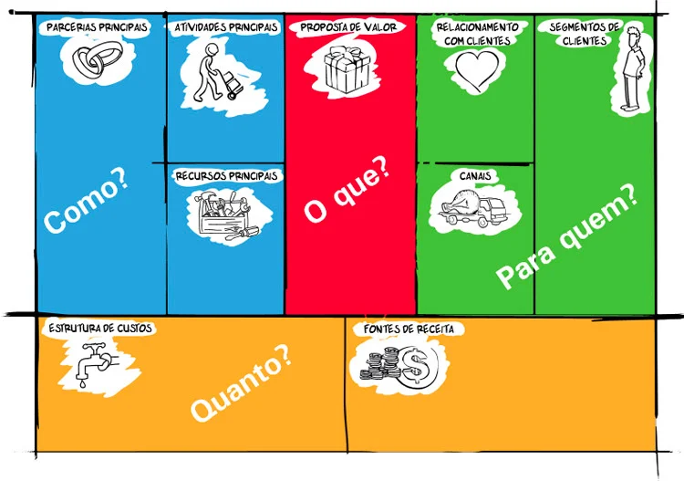

<!-- _class: lead -->

# Gestão de Projetos
## Aula 2 — PMBOK® e Business Model Canvas
 

---

# 📘 O que é o Guia PMBOK®?

**PMBOK®** = Project Management Body of Knowledge

Desenvolvido pelo **PMI** (Project Management Institute):
- Guia de **boas práticas** para gerenciamento de projetos
- Amplamente reconhecido como **padrão** na área
- Descreve **processos, ferramentas e técnicas** de melhores práticas
- Abrange desde o início até o encerramento do projeto

---
### 📌 Áreas cobertas:
- Definição de escopo
- Planejamento
- Execução
- Monitoramento e Controle
- Encerramento

---

# 👤 O Gerente de Projetos

O PMBOK® está centrado na figura do **Gerente de Projetos**

Ele deve compreender:
- As **10 áreas do conhecimento** do guia
- Os **processos** do gerenciamento
- Os **postulados** para gestão de projetos

### 🎯 Objetivo:
Alcançar o **sucesso do projeto** através do domínio técnico e metodológico

---

# 🏛️ 12 Princípios do PMBOK®

| | | |
|---|---|---|
| 1. Orientação ao Cliente | 2. Orientação a Objetivos | 3. Gestão Integrada |
| 4. Enfoque em Valor | 5. Liderança Eficaz | 6. Envolvimento dos Stakeholders |
| 7. Gerenciamento de Mudanças | 8. Gerenciamento de Riscos | 9. Aprendizado Contínuo |
| 10. Abordagem Baseada em Processos | 11. Ética e Responsabilidade Profissional | |

---

# ⚙️ Componentes do PMBOK®

### 49 processos divididos em:

**5 Grupos de Processos:**
1. 🚀 Iniciação
2. 📝 Planejamento
3. ⚡ Execução
4. 🔍 Monitoramento e Controle
5. ✅ Encerramento

---

**10 Áreas de Conhecimento:**
- Integração, Escopo, Cronograma, Custo, Qualidade
- Recursos, Comunicações, Riscos, Aquisições, Partes Interessadas

---

# 📊 Processos do PMBOK®

| Grupo | Nº de Processos | Exemplo |
|-------|-----------------|---------|
| Inicialização | 2 processos | 4.1 - Termo de Abertura; 13.1 - Identificar stakeholders |
| Planejamento | 24 processos | O grupo mais detalhado |
| Execução | 10 processos | Implementação das atividades |
| Monitoramento | 12 processos | Controle e acompanhamento |
| Encerramento | 1 processo | Finalização formal |

---
### 📌 A numeração segue o padrão:
**X.Y** onde X = capítulo (área) e Y = sequência do processo

---

# 📐 Acompanhamento do Projeto

### Ciclo de Vida do Projeto

Estrutura conceitual que descreve as fases desde o início até a conclusão:

| Ciclo | Característica |
|-------|----------------|
| **Preditivo** | Escopo detalhado, entregas definidas com antecedência |
| **Incremental** | Entregas por múltiplas interações, adiciona funcionalidades |
| **Adaptativo/Ágil** | Variáveis claras sob demanda, associado a metodologias ágeis |

---

# 🔄 Fases Mínimas do Projeto

### 1. 🚀 Início do Projeto
- Termo de Abertura (TAP) / Project Charter
- Formaliza a existência do projeto

### 2. 📋 Organização e Preparação
- Planejamento, cronograma, análise de custos
- Monitoramento e controle começa aqui
---
# 🔄 Fases Mínimas do Projeto
### 3. ⚡ Execução do Trabalho
- Consome maior parte do tempo e recursos
- Pode ser intercalada com planejamento

### 4. ✅ Encerramento
- Recursos alocados diminuem
- Produto entregue ao destinatário

---

# 📦 Business Model Canvas (BMC)

Framework desenvolvido por **Alexander Osterwalder** e **Yves Pigneur**:
- Modelo estruturado para visualizar o modelo de negócios
- Muito popular entre **empreendedores**, **empresas** e **startups**
- Organiza propostas de negócio de forma **estruturada e visual**

### 4 Perguntas-chave:
1. **O que** será criado?
2. **Como** será criado?
3. **Para quem** será criado?
4. **Quanto** de recursos irá movimentar?

---

### 📊 Os 9 Blocos do BMC

| Bloco | Pergunta |
|-------|----------|
| **Parceiros-chave** | Quem são os parceiros essenciais? |
| **Atividades-chave** | Quais atividades são críticas? |
| **Recursos-chave** | Quais recursos são necessários? |
| **Proposta de Valor** | Que valor entregamos ao cliente? |
| **Relacionamento** | Como nos relacionamos com clientes? |
| **Canais** | Como entregamos valor? |
| **Segmentos de Clientes** | Para quem criamos valor? |
| **Estrutura de Custos** | Quais são os custos principais? |
| **Fontes de Receita** | Como geramos receita? |

---

# ✅ Validação do BMC

Após elaborar o BMC, valide com estas perguntas:

1. A **proposta de valor** atende às necessidades do cliente?
2. Os **canais e relacionamento** dão condições para entregar a proposta?
3. Os **parceiros** têm capacidade de complementar as atividades?
4. Tenho acesso aos **recursos necessários** para realizar as atividades?
5. As **receitas** são suficientes para cobrir os gastos planejados?

---

---

# 💡 Exemplo Prático — BMC

### Aplicativo de delivery de comida para estudantes universitários

| Bloco | Resposta |
|-------|----------|
| **Parceiros-chave** | Restaurantes próximos às universidades, motoboys/entregadores, gateways de pagamento (Pix, cartão) |
| **Atividades-chave** | Desenvolvimento do app, gestão de pedidos, logística de entrega, promoções para estudantes |
| **Recursos-chave** | Equipe de TI, servidores em nuvem, frota de entregadores, contratos com restaurantes |
---
# 💡 Exemplo Prático — BMC

| Bloco | Resposta |
|-------|----------|
| **Proposta de Valor** | Refeições acessíveis com desconto estudantil, entregas rápidas no campus e pagamento facilitado |
| **Relacionamento** | Chat de suporte no app, programa de fidelidade, avaliações e feedback dos usuários |
| **Canais** | Aplicativo móvel (Android/iOS), redes sociais universitárias, panfletos no campus |
| **Segmentos de Clientes** | Estudantes universitários (graduação e pós), restaurantes e lanchonetes universitárias |
---
# 💡 Exemplo Prático — BMC
| Bloco | Resposta |
|-------|----------|
| **Estrutura de Custos** | Desenvolvimento do app, marketing, pagamento de entregadores, infraestrutura de servidores |
| **Fontes de Receita** | Comissão por pedido (15-20%), taxa de entrega, assinatura premium (entregas grátis), anúncios de restaurantes |

---

<!-- _class: lead -->

# 📝 Resumo da Aula

- **PMBOK®** = Guia de boas práticas do PMI
- **49 processos** em 5 grupos e 10 áreas de conhecimento
- **12 princípios** orientam a gestão de projetos
- **Business Model Canvas** = Framework visual de modelo de negócios
- **9 blocos** estruturam a proposta de valor

## 📚 Próxima Aula:
**Métodos Tradicionais e Kanban**

---

<!-- _class: lead -->

# Dúvidas? 🤔

**Gestão de Projetos — Aula 2**

📧 Contato do professor
